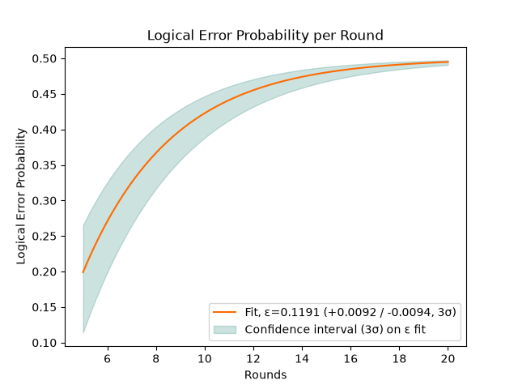

# deltakit-analyse

[](https://pypi.org/project/deltakit-analyse/)
[](https://pypi.org/project/deltakit-analyse/)
[](https://www.apache.org/licenses/LICENSE-2.0)

## Introduction

`deltakit-analyse` helps analyse quantum error correction (QEC) experiments by providing tools to post-process data from simulations or quantum hardware execution and visualise the results. It is one of the component packages of
[Deltakit](https://github.com/Deltakit/deltakit).

## Install

The `deltakit-analyse` package requires a Python version between `3.11` and `3.15`.

You can install with `pip`:

```bash
python -m pip install deltakit-analyse
```

If you use `uv`, you can install it in your current virtual environment with:
```bash
uv pip install deltakit-analyse
```

## Quick Start

Estimate the logical error probability per round (often called logical error rate and abbreviated LER) from logical failure data.

```python
import matplotlib.pyplot as plt

from deltakit_analyse import (
    calculate_lep_and_lep_stddev,
    compute_logical_error_per_round,
)
from deltakit_analyse.plotting import interpolate_leppr, plot_leppr

# Synthetic data for the example, replace this with results obtained from
# simulations or real hardware execution.
failed_shots = [9949, 8434, 9649, 9926]
total_shots = [50_000, 20_000, 20_000, 20_000]
rounds = [5, 10, 15, 20]

# LER computation requires to compute the logical error probability (LEP) first.
lep, lep_stddev = calculate_lep_and_lep_stddev(failed_shots, total_shots)
estimate = compute_logical_error_per_round(rounds, lep, lep_stddev)

print(
    f"Logical error probability per round: {estimate.leppr:.2%} ± {estimate.leppr_stddev:.2%}"
)

fig, _ = plot_leppr(interpolate_leppr(estimate))
plt.show()
```

Example output:

```text
Logical error probability per round: 11.91% ± 0.31%
```

with the following plot generated:



## Contributing

See the [Deltakit contributing guide](https://github.com/Deltakit/deltakit/#contributing).

## License

This project is licensed under the [Apache License 2.0](https://www.apache.org/licenses/LICENSE-2.0).
